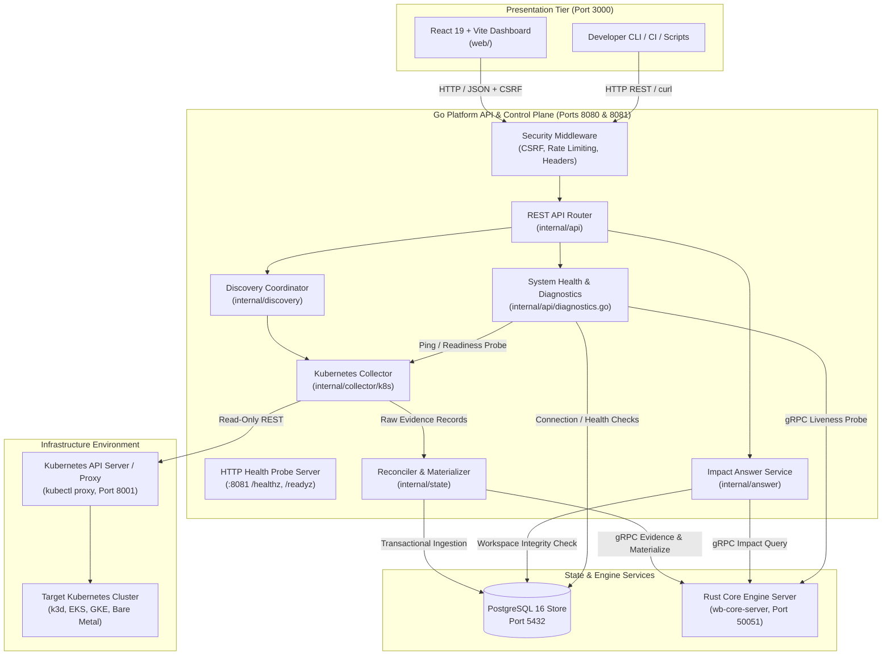
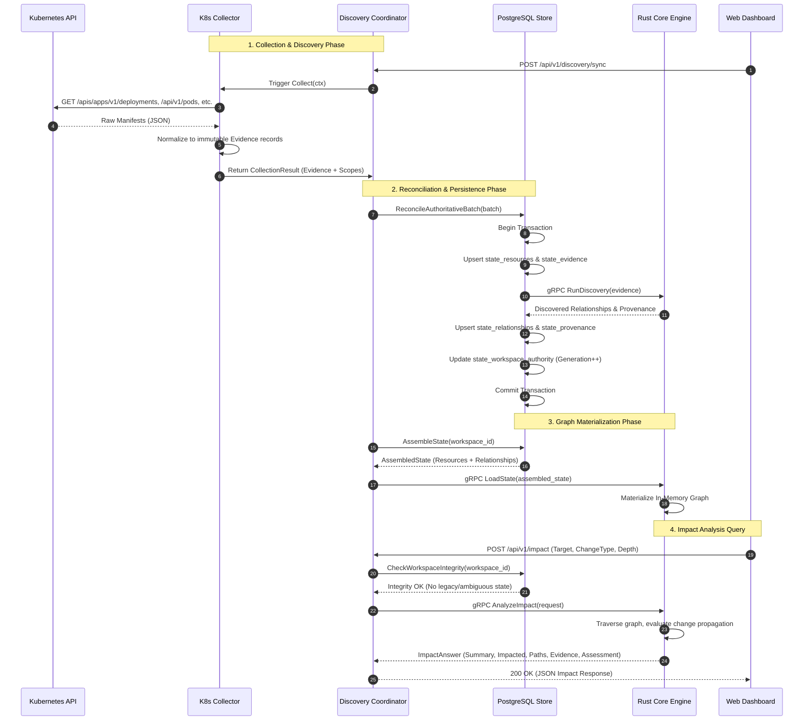

# WhatBreaks Architecture & System Design

WhatBreaks (WB) is a deterministic change-impact analysis and topology exploration platform for infrastructure. It identifies what other components could be affected before a change—such as a resource deletion, version update, scaling change, or replacement—is applied to an environment.

This document describes the architectural responsibilities, data flow, inter-process communication, persistence model, and integrity safeguards of the WhatBreaks V1 system.

---

## 1. High-Level Architecture

The WhatBreaks platform consists of three core tiers:

1. **Go Platform & Control Plane (`cmd/wb`, `internal/`)**: Manages HTTP REST APIs, authentication/CSRF boundaries, Kubernetes discovery coordination, state reconciliation, and gRPC communication with the graph calculation engine.
2. **Rust Core Engine (`core-engine/`, `core-engine-server/`)**: A high-performance, in-memory graph evaluation engine providing deterministic dependency traversal, semantic relationship derivation, and bounded blast-radius impact analysis.
3. **PostgreSQL State Store (Port 5432)**: The durable source of truth storing observed infrastructure resources, provenance evidence records, and materialized semantic relationships.
4. **Web Presentation Tier (`web/`, Port 3000)**: A React 19 + TypeScript dashboard powered by Vite, providing interactive dependency exploration, blast-radius simulation, and system diagnostics.

---

## 2. Component Ownership & Responsibilities

| Tier / Component | Technology | Primary Responsibilities |
| :--- | :--- | :--- |
| **Go Platform API** (`cmd/wb`, `internal/api`) | Go 1.22+ | Serves public HTTP REST APIs (`/api/v1/*`), enforces CSRF double-submit protection, applies rate limiting, provides system diagnostics, and serves health endpoints. |
| **Go Health Probes** (`internal/health`) | Go 1.22+ | Listens on a dedicated port (`8081`) to serve Kubernetes-standard liveness (`/healthz`) and readiness (`/readyz`) probes. |
| **Kubernetes Collector** (`internal/collector/k8s`) | Go 1.22+ | Executes read-only REST polling against target Kubernetes clusters. Sanitizes secret payloads to metadata keys only. Normalizes manifests into immutable Evidence records. |
| **Discovery Coordinator** (`internal/discovery`) | Go 1.22+ | Orchestrates collection sweeps, manages concurrency locks, prevents overlapping runs, and triggers state reconciliation. |
| **State & Reconciler** (`internal/state`) | Go 1.22+ | Manages PostgreSQL transactional schema, reconciles observation batches with generation checks, materializes assembled graph snapshots, and executes administrative recovery. |
| **Answer Service** (`internal/answer`) | Go 1.22+ | Validates incoming impact requests, enforces workspace identity integrity, delegates to Core Engine via gRPC, and enriches blast-radius responses with explanations. |
| **Rust Core Engine** (`core-engine/`, `core-engine-server/`) | Rust 1.75+ | High-performance graph modeling, deterministic discovery rules, graph traversal, cycle-safe blast-radius evaluation, and structured fact synthesis. |
| **PostgreSQL Database** (`docker-compose.yml`) | PostgreSQL 16 | Durable system-of-record storing resources, evidence history, relationship provenance, discovery conflicts, diagnostics, and recovery audits. |
| **Web Dashboard** (`web/`) | React 19, TypeScript, Vite | User interface providing resource inventory browsing, topological graph rendering, change-impact simulation, and interactive system diagnostics. |

---

## 3. Communication & Interface Protocols

### A. Go Platform ↔ Rust Core Engine (gRPC / Protobuf)

Communication between the Go control plane and the Rust Core Engine occurs over a local gRPC channel (`wb.core.v1`) on port `50051`.

The contract is formally defined in [`proto/wb/core/v1/core.proto`](file:///Users/aaradhychinche/Documents/WB/whatbreaks/proto/wb/core/v1/core.proto):

1. **`DiscoveryService`**:
   - `RunDiscovery(RunDiscoveryRequest) returns (RunDiscoveryResponse)`: Takes a batch of point-in-time `Evidence` records and applies registered discovery rules (Ownership, Resource Reference, Runtime Connection) to yield candidate relationships and diagnostics.
2. **`AnswerService`**:
   - `AnalyzeImpact(AnalyzeImpactRequest) returns (AnalyzeImpactResponse)`: Evaluates candidate blast radius around a target resource for a proposed change (`DELETE`, `UPDATE`, `SCALE`, `REPLACE`) up to a specified depth.
   - `LoadState(LoadStateRequest) returns (LoadStateResponse)`: Replaces or loads the in-memory graph for a workspace using assembled resources and relationships from PostgreSQL.
   - `InvalidateWorkspace(InvalidateWorkspaceRequest) returns (InvalidateWorkspaceResponse)`: Evicts in-memory workspace graph state upon administrative recovery or invalidation.

### B. Frontend ↔ Go Platform API (HTTP REST)

The React web application interacts with the Go API on port `8080` (proxied via Vite during local development):

- **Data format**: JSON over HTTP/1.1.
- **CSRF Defense**: Double-submit cookie pattern (`X-CSRF-Token` header validated against cookie).
- **Tenant Scope**: `X-Workspace-ID` header (or `?workspace_id=` query parameter) specifying the tenant UUID.

### C. Kubernetes Collector ↔ Kubernetes API Server (HTTP REST)

The Kubernetes collector connects to an explicit API base URL (defaulting to `http://127.0.0.1:8001` via `kubectl proxy` or in-cluster service endpoint):

- **Protocol**: HTTP/HTTPS REST using Go standard `net/http`.
- **Permissions**: Strictly read-only (`get`, `list`). Zero mutating verbs (`create`, `update`, `patch`, `delete`).
- **Secret Safety**: Inspects only `.metadata` and the map keys of `.data`. Secret payloads, private keys, and certificates are never read or stored.

---

## 4. End-to-End Data Flow

The following sequence illustrates how infrastructure manifests are discovered, stored, materialized, and queried for impact analysis:

---

## 5. In-Memory Graph & Impact Propagation

The Rust Core Engine maintains an in-memory directed graph representation of the infrastructure topology:

### Graph Topology
- **Nodes**: Uniquely identified by canonical `ResourceIdentity` (`provider`, `resource_type`, `provider_id`).
- **Edges**: Directed semantic relationships (`source` $\rightarrow$ `target`) with a specific `kind` and `category`.

### Canonical Relationship Kinds
- `OWNS` / `CONTROLS` (Ownership, e.g. Deployment $\rightarrow$ ReplicaSet $\rightarrow$ Pod)
- `SELECTS` / `ROUTES_TO` (Traffic routing, e.g. Ingress $\rightarrow$ Service $\rightarrow$ Pod)
- `MOUNTS` / `USES` (Resource configuration reference, e.g. Pod $\rightarrow$ ConfigMap, Pod $\rightarrow$ Secret)
- `CONNECTS_TO` (Observed runtime network connection)

### Propagation Semantics
When an operator proposes a change on a target resource, the Core Engine traverses the graph according to deterministic rules:

1. **Direction**:
   - `incoming`: Traverses upstream dependents/callers (i.e. who depends on the target and could break if the target changes).
   - `outgoing`: Traverses downstream dependencies (i.e. what the target depends on).
2. **Change Type Semantics**:
   - `DELETE`: Outages propagate upward through routing and ownership edges. Multi-hop traversal is permitted up to `max_depth`.
   - `UPDATE`: Non-structural configuration updates impact immediate consumers. By architectural invariant, `UPDATE` and `REPLACE` operations enforce a maximum propagation depth of `1`.
   - `SCALE`: Scaling changes affect downstream capacity and immediate upstream routing pools.
   - `REPLACE`: Replacement can cause transient disruption to direct callers (depth clamped to `1`).

---

## 6. Workspace Isolation & Identity Integrity

WhatBreaks enforces strict multi-tenancy and data hygiene safeguards:

1. **Workspace Boundary**: Every database table partitions data by `workspace_id` (UUIDv4). Cross-workspace queries are strictly forbidden.
2. **Canonical Kubernetes Identity Format**:
   - Cluster-scoped resources: `<cluster_id>/<name>` (e.g. `prod-cluster/kube-system`)
   - Namespaced resources: `<cluster_id>/<namespace>/<name>` (e.g. `prod-cluster/default/order-service`)
3. **Integrity Guard (`IDENTITY_INTEGRITY_REJECTED`)**:
   Before materializing a graph or evaluating impact, the system verifies that the workspace contains no ambiguous or legacy identities lacking cluster qualification. If legacy records exist, queries are halted with HTTP `422 Unprocessable Entity` until administrative recovery is executed.
4. **Administrative Recovery (`internal/state/recovery.go`)**:
   Provides an audited, transactional workflow (`POST /api/v1/system/recover`) to archive legacy state, wipe un-prefixed records, and trigger fresh, cluster-qualified discovery sweeps.
